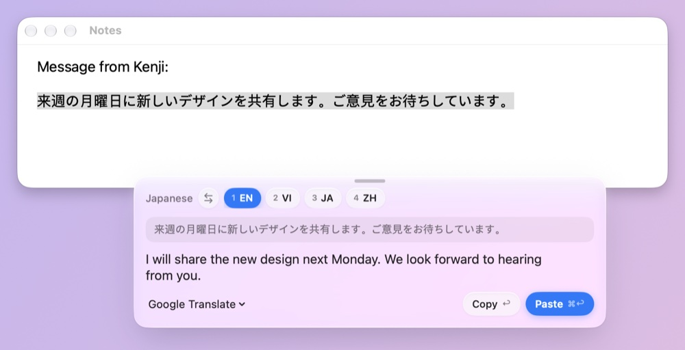
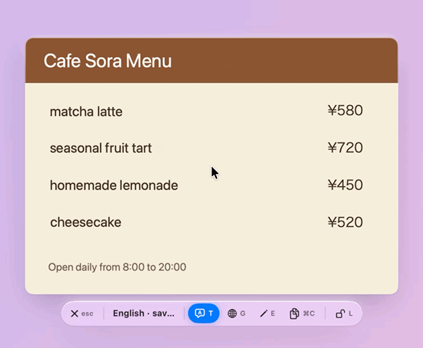
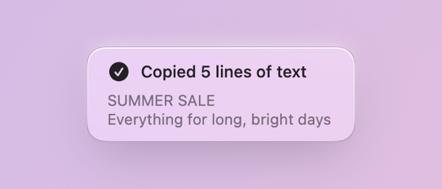
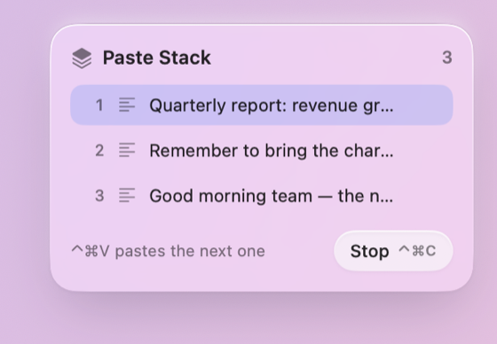

# PasteClip


A free, open-source clipboard manager for macOS, written in Swift (AppKit + SwiftUI).

PasteClip keeps everything you copy (text, links, images, files, colours) and brings it back with
one shortcut: press **⇧⌘V**, pick a card, and it is pasted into the app you were using.

## Highlights

### Your clipboard history, one shortcut away
Press **⇧⌘V**: every recent clip slides in as a card, from text and links to images and colours.
Arrow through them, Space for a large preview, Tab through your pinboards, type to search,
Return to paste.


### Translate what you select
Select text in any app and press **⌃Space**: the translation appears by the pointer. Number keys
switch the language, Return copies it, ⌘Return pastes it in place of the selection. Google and
Bing work without a key, Apple's translation runs on your Mac, and DeepL, Microsoft and AI models
(OpenAI, Claude, Gemini, DeepSeek, Grok) work with your own API key.



### Translate the text in an image, in place
Like a camera translator for your screen: the translation is drawn where the text was, over the
same background. Point at any line to see the original; click it to copy. T switches between the
translation and the original.



### Capture, mark up, float
**⇧⌘1** captures an area of the screen; a card in the corner offers Edit, Float and Translate.
The editor has arrows, boxes, text, highlighter, numbered steps, pixelate and crop, each on one key.

<table>
<tr>
<td width="36%"></td>
<td></td>
</tr>
</table>

### Keep an image in view, and copy its text
**⌃F** floats an image above every window: for a reference, a spec or a colour palette while you
work. Zoom, fade it, or let clicks pass through. Its text can be selected and copied with Live Text.


### Copy text from the screen, paste several things in order
**⌥⇧⌘2** copies the text in any area of the screen, read on your Mac. The paste stack collects
what you copy and pastes it back one by one, in the same order.

<table>
<tr>
<td></td>
<td></td>
</tr>
</table>

All demos use sample content; nothing in them comes from a real clipboard.

## Install

1. Download **`PasteClip-<version>.dmg`** from the [latest release](https://github.com/classmethod-dn-labs/cmdn-tool-pasteclip/releases/latest).
2. Open it and drag **PasteClip** into **Applications**.
3. Open PasteClip from Applications. It runs in the menu bar (there is no Dock icon).

Requires macOS 15 Sequoia or later, on Apple silicon or Intel.

### First launch

PasteClip is not notarized by Apple yet, so macOS blocks the first launch: open the app once
and close the warning, then go to **System Settings → Privacy & Security**, scroll down and
click **Open Anyway**.

Or, from Terminal: `xattr -dr com.apple.quarantine /Applications/PasteClip.app`

### Permissions

To paste straight into other apps, PasteClip needs **Accessibility** access. It asks the first
time you paste; turn it on in **System Settings → Privacy & Security → Accessibility**.
Without it, PasteClip still copies the clip, and you press ⌘V yourself.

### Update and uninstall

- **Update:** quit PasteClip from the menu bar, then replace it in Applications with the new version.
  Your history and pinboards are kept.
- **Uninstall:** quit PasteClip, move it to the Trash, and delete
  `~/Library/Application Support/PasteClip` to remove your history.

## All features

### Clipboard history

- **History** of text, formatted text (RTF/HTML), links, colours, images and files, with the app each clip came from
- **Shelf**: ⇧⌘V slides in a panel of cards from the bottom (or top) of the screen
- **Search** across text, titles, file paths, source apps and text found in images (Vision), plus filters by type, app and date
- **Pinboards**: named, coloured collections for clips you want to keep
- **Paste stack**: copy several things, then paste them one by one in the same order
- **Preview and edit**: Space for a large preview (Quick Look for images and files) with copy, translate and edit at hand, give clips a title, edit text clips. Esc saves an edit everywhere, ⌥Esc discards it
- **Direct paste** into the current app, or paste as plain text (needs Accessibility permission)

### Translation

- **Translate**: ⌃Space translates the selected text (or the clipboard) in a small panel by the pointer. It picks the language for you: Vietnamese text into English, anything else into Vietnamese; 1–4 switch between Vietnamese, English, Japanese and Chinese. Click the text (or press E) to edit it in place: the translation follows as you type. R translates the translation back. Return copies, ⌘Return pastes the translation back into the app. With the shelf open, ⌃Space translates the selected clips instead. Uses Google Translate or Bing Translator (free, no key) or Apple's on-device translation; Google Cloud, DeepL and Microsoft, and the AI models of OpenAI, Claude, Gemini, DeepSeek and Grok, work with your own API key (the model can be chosen)
- **Translate images**: the translation drawn where the text is, like a camera translator: the original letters are taken out while the photo or gradient behind them stays, turned text stays turned, vertical Chinese and Japanese are read and written in columns, and codes, IDs and logos are left alone. On macOS 26 Vision's layout keeps columns and table cells apart. Point at any text on the translated image to see what was read there, translated or not; click it to copy that text. ⇧⌘2 does it for an area of the screen, in place; ⌃⌥Space for images in the shelf; T on a floating image. The translated image is saved as a clip (can be turned off in Settings → Translation)

### Images and the screen

- **Screenshots**: ⇧⌘1 captures an area as an image clip and copies it; a card in the corner then offers Edit (E), Float (P) and Translate (T); any other key closes it and goes on to the app you're typing in
- **Mark up images**: ⌘E on an image clip opens an editor with arrows, boxes, text, highlighter, numbers, pixelate and crop, each on one key. Esc saves the result as a new clip
- **Float images**: ⌃F keeps an image above every window. Its text can be selected and copied (⌘C) with Live Text, as in Preview. Scroll up or down to make it clearer or fainter, pinch to zoom, L to let clicks pass through
- **Copy text from the screen**: ⌥⇧⌘2, pick an area, and its text is copied. English, Vietnamese, Japanese and Chinese by default; more languages in Settings → Text Recognition. Read on your Mac with Vision (needs Screen Recording permission)

### Privacy and settings

- **Privacy**: skips clips that password managers mark as private, and anything copied in apps you exclude
- **Light or dark**: the sun / moon button at the top right of the shelf switches PasteClip between light and dark; Settings → General → Appearance goes back to following the system
- **Settings**: paste into the front app or only copy, always plain text, history retention, translation (languages and their order, service, API keys), privacy options (screen sharing, link previews, passwords, temporary clips, ignored apps), shortcuts, sounds, launch at login

See [docs/SPEC.md](docs/SPEC.md) for the full functional spec.

## Build from source

Only Command Line Tools are needed (Xcode is not required):

```sh
./scripts/bundle.sh          # creates build/PasteClip.app
open build/PasteClip.app
./scripts/test.sh            # run the tests
./scripts/release.sh         # universal build, packaged as dist/PasteClip-<version>.dmg and .zip
```

The version comes from `CFBundleShortVersionString` in `Resources/Info.plist`. The app icon is
drawn by `swift scripts/make-icon.swift`, which writes `Resources/AppIcon.icns`.

Run `./scripts/make-signing-cert.sh` once before building. It creates a self-signed
"PasteClip Local Signing" certificate in your login keychain, and `bundle.sh` signs with it, so
every build has the same identity and macOS keeps the Accessibility permission. Without it the
app is signed ad hoc, macOS treats each rebuild as a new app, and asks for permission again
(`tccutil reset Accessibility io.github.cmdn-vinhdang.pasteclip` clears the stale entries).

## Global shortcuts

All eight can be changed or removed in Settings → Shortcuts. They come before the app in front's own
shortcuts, so change any that get in the way.

| Key | Action |
|---|---|
| ⇧⌘V | Open or close the shelf |
| ⌃⌘C | Start or stop the paste stack |
| ⌃⌘V | Paste the next clip from the stack |
| ⇧⌘1 | Screenshot of an area (or a window, with Space), saved as a clip and copied; a card in the corner offers Edit E, Float P, Translate T (Settings → General can instead always copy, edit or float) |
| ⇧⌘2 | Translate an area of the screen: the translation floats over it, where the text was |
| ⌥⇧⌘2 | Copy text from an area of the screen |
| ⌃F | Float the latest image (with the shelf open: the selected images) |
| ⌃Space | Translate the selected text, or the clipboard |

⌃Space is also macOS's shortcut for switching input sources. If that one is turned on
(System Settings → Keyboard → Keyboard Shortcuts → Input Sources), macOS takes the key first:
turn it off there or pick another shortcut. Settings shows a warning next to any shortcut macOS uses.

## In a translation

| Key | Action |
|---|---|
| 1…9 / ← → | Translate into another language (⌘1…⌘9 while editing) |
| E / Tab / click the text | Edit the text; it's translated again as you type. Esc finishes editing; Revert brings back the text as it came |
| R | Translate the translation back, into the language the text was in |
| ↑ ↓ | Switch to the previous / next translation service |
| Return / ⌘C | Copy the translation |
| ⌘Return | Paste it into the app you were using, replacing the selection |
| ⌘O | Show or hide the text being translated |
| ⌘I | Show on Image: the image floated with the translation where its text was (when translating an image) |
| Esc / click outside | Close (while editing, Esc first finishes editing) |

## In the image editor

| Key | Action |
|---|---|
| V R O L A T P H B N C | Select, rectangle, ellipse, line, arrow, text, pen, highlighter, pixelate, number, crop |
| 1…6 / [ ] / F | Colour / size / fill |
| ⇧ while drawing | Square, circle, 45° line |
| ⌫ / arrows | Delete / nudge the selected mark |
| ⌘Z / ⇧⌘Z | Undo / redo |
| ⌘+ ⌘− ⌘0 | Zoom in, out, fit |
| Esc / Return / ⌘S | Save as a new clip and close (in crop: Esc cancels, Return applies) |
| ⌘C / ⌃F | Save, then copy / float it |
| ⌥Esc | Close without saving |

## On a floating image

These work with the pointer over the image, without clicking it first.

| Key | Action |
|---|---|
| Scroll up / down, ↑ ↓ | Clearer / fainter |
| Pinch, ⌘ scroll, ⌘+ ⌘−, − + in the readout | Zoom |
| ⌘0 / double-click | Actual size / fit |
| T / hold Space / ← → or 1…9 | Translate where the text is, or back to the original / peek at the original / into the previous, next or that language |
| G | Open the original image in Google Translate's Images page: it's opened (in the Google Translate tab already open, if there is one) and pasted there for you, and the floating image closes |
| E / ⌘C | Edit / copy |
| L | Lock: clicks pass through. The strip under it still shows when the pointer is over it, with the button to unlock it |
| Esc / ⌘W | Close |

## Shortcuts in the shelf

| Key | Action |
|---|---|
| ← → | Select a card |
| ⇧← ⇧→ / ⇧-click | Select several cards in a row |
| ⌘-click | Add a card to the selection, or take it out |
| ⌘A | Select every card (when the search is empty; otherwise the search text) |
| Return / double-click | Paste into the app you were using (hold ⇧ for plain text). With several cards selected, Return pastes them together, a line apart |
| ⌘R / double-click a card's label | Name the clip; the name shows on the card instead of the time (Return or Esc saves, ⌥Esc cancels, empty removes it) |
| ⌘1…⌘9 | Paste a card quickly (hold ⌘ to see the numbers; hold it a moment longer to see the shelf's keys) |
| Space / ⌘Y | Preview in a popup above the card; ← → move it to the next clip (Space works when the search field is empty) |
| ⌘E | Edit a text clip (Esc or ⌘S saves, ⌥Esc discards), or mark up an image (also a single copied image file) |
| ⌃F | Float the selected images on the screen (configurable) |
| ⌘C | Copy without pasting, and close (several cards: copied together; text selected in the search or the preview is copied as text) |
| ⌘V ⌘X ⌘Z | Edit the search text |
| ⌃Space (the translate shortcut) | Translate the selected clips: text, or the text in an image (read on the spot if it hasn't been yet) |
| ⌘I | Show only images (the Images button), or every type again |
| ⌃⌥Space | Float the selected images, translated where their text is (configurable) |
| ⌘⌫ | Delete (every selected card) |
| ⌘→ / ⌘← or Tab / ⇧Tab | Next / previous pinboard |
| ⌘N | New text item (Esc saves, ⌥Esc discards) |
| ⌘F | Search |
| ⌘, | Settings |
| Esc / click outside | Clear a selection of several cards, then close |

Right-click a card to add it to a pinboard or the paste stack. Right-click a pinboard tab to edit or delete it.
Drag a pinboard tab onto another to reorder the pinboards, and drag cards within a pinboard to arrange them.

## Architecture

```
Sources/
  PasteClipCore/          Library, no UI
    ClipItem.swift        Clip model, kind detection, hex colours
    Pinboard.swift        Pinboard model
    ClipStore.swift       Polls NSPasteboard.changeCount, de-duplicates, limits, stack, pinboards, JSON files
    ClipQuery.swift       Search and filters
    AppSettings.swift     Preferences and shortcut definitions (UserDefaults)
    TextRecognizer.swift  Text in images through Vision, one pass per writing system, merged line by line
    ImageMarkup.swift     Image marks, drawing and saving them; opacity steps of floating images
    ImageTranslation.swift  Lines into paragraphs, and translations drawn where the text was
  PasteClipSystem/        Library, OS integration
    HotKey.swift          Global hotkeys through Carbon RegisterEventHotKey
    Paster.swift          Sends ⌘V through CGEvent
  PasteClip/              The app
    main.swift            Entry point; runs as an accessory app (no Dock icon)
    AppDelegate.swift     Menu bar item, hotkeys, wiring
    ShelfPanel.swift      Non-activating NSPanel and keyboard handling
    ShelfView.swift       Toolbar, pinboard tabs, filters, cards
    CardsRow.swift        Row of cards: selection, clicks, drag, right-click menu
    ClipCard.swift        Card (content edge to edge, name label, details on hover), drag provider, colour swatch, pinboard editor
    LinkPreviews.swift    Page titles and images for links (LinkPresentation)
    PreviewPopup.swift    Preview popup above the selected card: title, editing, Quick Look
    StackPanel.swift      Floating paste stack list
    ScreenTextCapture.swift  Copy text from the screen: system area picker, Vision, confirmation toast
    SettingsWindow.swift  Settings window and shortcut recorder
    ImageEditor.swift     Image editor window: canvas, tools, undo, saving as a new clip
    FloatingImage.swift   Images floated above every window: opacity, zoom, lock, translation
    ImageTranslator.swift Reads, translates and redraws an image with the chosen service
    ViewState.swift       Stand-in for @State (see below)
Tests/
  PasteClipCoreTests/     Capture, rich text, de-dup, limits, pinboards and their order, stack, query
```

How it works: macOS has no notification for clipboard changes, so `ClipStore` checks
`changeCount` every 0.4 seconds. When the shelf is open, the panel is `nonactivatingPanel`, which keeps
the app you were using frontmost. When you choose a clip, PasteClip writes it to the pasteboard,
closes the shelf, waits until you let go of modifier keys, and then sends ⌘V to that app.

### Building without Xcode

With the macOS 27 SDK, SwiftUI's `@State` is a macro whose plugin ships only with Xcode, so
views keep local state in a `ViewState` object through `@StateObject` instead. Likewise,
`swift test` doesn't find the Swift Testing macro plugin from the Command Line Tools on its
own, so `scripts/test.sh` passes its path.

Run `PasteClip --open shelf|preview|general|text|privacy|shortcuts` (the binary inside the app, or from
`swift build --show-bin-path`) to jump straight to a screen while working on the UI.
